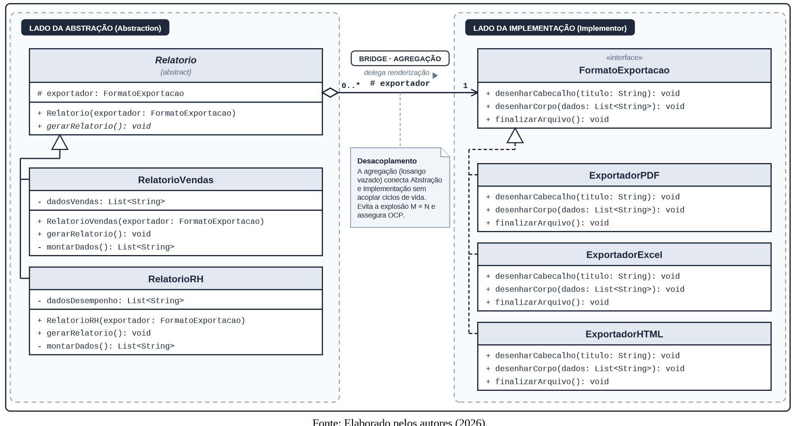
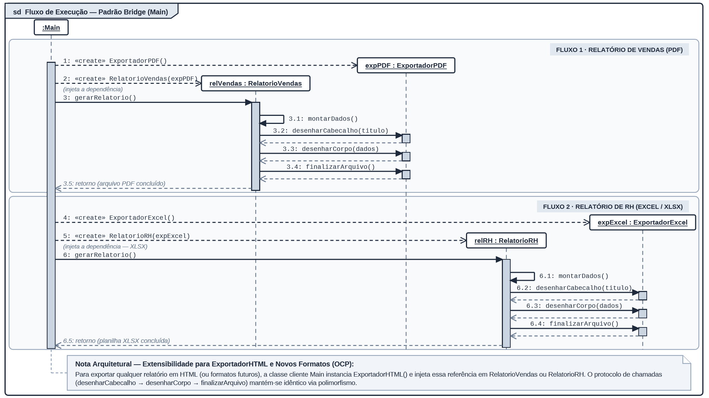

# TechFatec — Sistema de Relatórios Corporativos (Padrão Bridge)

> **Instituição:** Faculdade de Tecnologia da Zona Leste (FATEC Zona Leste)  
> **Disciplina:** Modelagem de Padrões de Projetos — Prof. Marcelo Collado  
> **Tema:** Padrão Estrutural Bridge (GoF) & Princípio Aberto/Fechado (OCP - SOLID)  
> **Integrantes:**  
> - Pablo de Sousa Santos  
> - Pedro Fernandes Araújo  

---

## 1. Contexto do Problema e Fundamentação Arquitetural

A equipe de engenharia do sistema de inteligência de negócios **TechFatec** necessita expandir o módulo de geração de relatórios:
- **Sistema Legado:** Produzia exclusivamente o `Relatório de Vendas` acoplado ao formato `PDF`.
- **Novo Requisito:** Inclusão do `Relatório de Desempenho de RH`, estipulando que todos os relatórios (atuais e futuros) sejam exportáveis para **PDF**, **Excel (XLSX)** e **HTML**.

### 1.1 O Problema da Explosão de Subclasses
Quando o tipo de relatório e o formato de exportação coexistem em uma única árvore de herança rígida, cada novo formato multiplica o total de classes ($M \times N$), exigindo seis subclasses concretas para dois relatórios e três formatos (`RelatorioVendasPDF`, `RelatorioVendasExcel`, `RelatorioVendasHTML`, `RelatorioRHPDF`, `RelatorioRHExcel`, `RelatorioRHHTML`). O Padrão **Bridge** converte esse crescimento em linear ($M + N$) por meio de delegação via agregação:

| Critério | Herança Rígida (Acoplada) | Solução com Padrão Bridge |
| :--- | :--- | :--- |
| **Crescimento** | Multiplicativo ($M \times N$): 2 relatórios $\times$ 3 formatos geram 6 subclasses concretas acopladas. | Linear ($M + N$): 2 abstrações concretas + 3 exportadores, totalizando 5 classes concretas. |
| **Acoplamento** | Regras de negócio do relatório misturadas à escrita física do arquivo. | Delegação via interface `FormatoExportacao` e agregação em `Relatorio`. |
| **Evolução** | Um 3.º relatório e um 4.º formato elevam a árvore para 12 classes. | Basta criar 1 subclasse de `Relatorio` ou 1 classe de `FormatoExportacao`. |

### 1.2 Aderência ao Princípio Aberto/Fechado (OCP - SOLID)
- **Extensão na Abstração:** Novos relatórios (ex.: futuro `RelatorioFinanceiro`) herdam de `Relatorio` e tornam-se imediatamente exportáveis para PDF, Excel e HTML sem modificar nenhum exportador.
- **Extensão na Implementação:** Novos formatos (ex.: CSV ou JSON) apenas implementam `FormatoExportacao`, ficando disponíveis para `RelatorioVendas` e `RelatorioRH` sem alterar uma única linha das classes de relatório.

---

## 2. Modelagem Estrutural: Diagrama de Classes UML 2.5

A modelagem estrutural divide o módulo em duas hierarquias ortogonais — **Lado da Abstração** e **Lado da Implementação** — conectadas pela ponte de **agregação** (`# exportador: FormatoExportacao`):



### Especificação dos Componentes
1. **Lado da Abstração (`/src/abstracao/`):**
   - **`Relatorio` (`{abstract}`):** Declara o atributo protegido `# exportador: FormatoExportacao`, o construtor para injeção da dependência, o método `setExportador(...)` para substituição dinâmica em tempo de execução e o método abstrato `gerarRelatorio(): void`.
   - **`RelatorioVendas`:** Subclasse concreta que declara o atributo privado `- dadosVendas: List<String>`, organiza seus dados por meio do método privado `- montarDados(): List<String>` e delega a geração do arquivo à referência `exportador`.
   - **`RelatorioRH`:** Subclasse concreta que declara o atributo privado `- dadosDesempenho: List<String>`, organiza seus dados por meio do método privado `- montarDados(): List<String>` e delega a geração do arquivo à referência `exportador`.
2. **Lado da Implementação (`/src/implementacao/`):**
   - **`FormatoExportacao` (`«interface»`):** Define o contrato com as operações primitivas `desenharCabecalho(titulo: String): void`, `desenharCorpo(dados: List<String>): void` e `finalizarArquivo(): void`.
   - **`ExportadorPDF`, `ExportadorExcel` e `ExportadorHTML`:** Implementadores concretos que realizam a interface `FormatoExportacao` para cada tecnologia de saída.

---

## 3. Modelagem Comportamental: Diagrama de Sequência UML 2.5

O diagrama de sequência detalha o protocolo de execução disparado pela classe cliente `Main` em quatro etapas sequenciais (mensagens `1` a `3.5` no Fluxo 1 e `4` a `6.5` no Fluxo 2):

1. **Instanciação do exportador (mensagens 1 e 4):** `:Main` cria o implementador concreto desejado (`ExportadorPDF`, `ExportadorExcel` ou `ExportadorHTML`) via mensagem `«create»`.
2. **Injeção de dependência (mensagens 2 e 5):** `:Main` instancia `RelatorioVendas` ou `RelatorioRH` passando a referência do exportador no construtor, armazenando-a no atributo protegido `# exportador`.
3. **Invocação da geração (mensagens 3 e 6):** `:Main` chama o método polimórfico `gerarRelatorio()` sobre a abstração, sem conhecer detalhes do formato concreto.
4. **Preparação, delegação e retorno (mensagens 3.1 a 3.5 e 6.1 a 6.5):** O relatório prepara seus dados por meio do método privado `montarDados()` (mensagens `3.1` e `6.1`), aciona `desenharCabecalho(titulo)`, `desenharCorpo(dados)` e `finalizarArquivo()` na instância de `FormatoExportacao` (mensagens `3.2` a `3.4` e `6.2` a `6.4`) e devolve o controle ao cliente ao término da exportação (mensagens `3.5` e `6.5`).



### Matriz de Combinações Suportadas ($2 \text{ abstrações} \times 3 \text{ formatos}$)

| Abstração Concreta | PDF (`ExportadorPDF`) | Excel (`ExportadorExcel`) | HTML (`ExportadorHTML`) |
| :--- | :--- | :--- | :--- |
| **`RelatorioVendas`**<br>Título: *"Relatório de Vendas"* | `new RelatorioVendas(new ExportadorPDF())`<br>Preserva o comportamento legado. | `new RelatorioVendas(new ExportadorExcel())`<br>Exportação tabular XLSX. | `new RelatorioVendas(new ExportadorHTML())`<br>Publicação em página HTML. |
| **`RelatorioRH`**<br>Título: *"Relatório de Desempenho de RH"* | `new RelatorioRH(new ExportadorPDF())`<br>Novo relatório em PDF. | `new RelatorioRH(new ExportadorExcel())`<br>Novo relatório em XLSX. | `new RelatorioRH(new ExportadorHTML())`<br>Novo relatório em HTML. |

---

## 4. Arquitetura Física de Diretórios

```text
Projeto_BRIDGE/
├── docs/
│   ├── diagrama_classes.png        # Diagrama de Classes UML 2.5 (Fase 1)
│   └── diagrama_sequencia.png      # Diagrama de Sequência UML 2.5 (Fase 1)
├── src/
│   ├── abstracao/                  # Hierarquia de Abstração (Relatórios)
│   │   ├── Relatorio.java          # Classe abstrata base (Ponte de Agregação)
│   │   ├── RelatorioVendas.java    # Abstração Refinada: Relatório de Vendas
│   │   └── RelatorioRH.java        # Abstração Refinada: Relatório de Desempenho de RH
│   ├── implementacao/              # Hierarquia de Implementação (Formatos)
│   │   ├── FormatoExportacao.java  # Interface Implementor
│   │   ├── ExportadorPDF.java      # Implementador Concreto: PDF
│   │   ├── ExportadorExcel.java    # Implementador Concreto: Excel (XLSX)
│   │   └── ExportadorHTML.java     # Implementador Concreto: HTML
│   └── cliente/                    # Camada Cliente / Validação
│       └── Main.java               # Script de validação das 3 rotinas exigidas
├── .gitignore
└── README.md
```

---

## 5. Injeção de Dependência e Desacoplamento

1. **Vedação ao operador `new` nas Abstrações:** Nenhuma classe do pacote `abstracao` instancia exportadores concretos diretamente. As classes de relatório conhecem apenas a interface `FormatoExportacao`.
2. **Injeção via Construtor:** O objeto implementador (`ExportadorPDF`, `ExportadorExcel` ou `ExportadorHTML`) é criado externamente pelo cliente (`Main`) e injetado via construtor em `RelatorioVendas` ou `RelatorioRH`.
3. **Troca Dinâmica em Tempo de Execução:** O método `setExportador(FormatoExportacao)` na classe `Relatorio` permite que a mesma instância de relatório altere seu formato de exportação em *runtime* sem recriação do objeto de negócio.

---

## 6. Como Compilar e Executar

Na raiz do projeto, execute no terminal:

```bash
# 1. Compilar os pacotes Java para o diretório bin/
javac -encoding UTF-8 -d bin src/implementacao/*.java src/abstracao/*.java src/cliente/*.java

# 2. Executar o script de validação (Cliente)
java -cp bin cliente.Main
```

### Saída no Console

```text
==================================================================
  TECHFATEC - MÓDULO DE RELATÓRIOS CORPORATIVOS (PADRÃO BRIDGE)   
==================================================================

>>> [ROTINA 1] Gerando Relatório de Vendas em PDF:
[PDF] === CABEÇALHO DO DOCUMENTO: Relatório de Vendas (TechFatec) ===
[PDF] Renderizando páginas do relatório:
  - Produto: Licença ERP TechFatec | Qtd: 120 | Total: R$ 240.000,00
  - Produto: Módulo BI Analytics   | Qtd: 85  | Total: R$ 170.000,00
  - Produto: Consultoria Cloud     | Qtd: 40  | Total: R$ 120.000,00
[PDF] Documento PDF finalizado e assinado com sucesso.

>>> [ROTINA 2] Alterando dinamicamente o MESMO Relatório de Vendas para Excel (XLSX):
[EXCEL/XLSX] Criando aba principal da planilha: [Relatório de Vendas - TechFatec]
[EXCEL/XLSX] Preenchendo linhas e células tabulares:
  [Linha 1] | Produto: Licença ERP TechFatec | Qtd: 120 | Total: R$ 240.000,00 |
  [Linha 2] | Produto: Módulo BI Analytics   | Qtd: 85  | Total: R$ 170.000,00 |
  [Linha 3] | Produto: Consultoria Cloud     | Qtd: 40  | Total: R$ 120.000,00 |
[EXCEL/XLSX] Planilha .xlsx gravada e fechada com sucesso.

>>> [ROTINA 3] Gerando Relatório de Desempenho de RH em HTML:
[HTML] <!DOCTYPE html>
[HTML] <html><head><title>Relatório de Desempenho de RH - TechFatec</title></head><body>
[HTML]   <h1>Relatório de Desempenho de RH - TechFatec</h1>
[HTML]   <ul>
[HTML]     <li>Colaborador: Ana Silva     | Cargo: Engenheira de Dados | Meta: 98% (Atingida)</li>
[HTML]     <li>Colaborador: Carlos Mendes | Cargo: Arquiteto de BI     | Meta: 95% (Atingida)</li>
[HTML]     <li>Colaborador: Beatriz Costa | Cargo: Analista de Sistemas| Meta: 92% (Atingida)</li>
[HTML]   </ul>
[HTML] </body></html>
[HTML] Página HTML exportada com sucesso.
```
